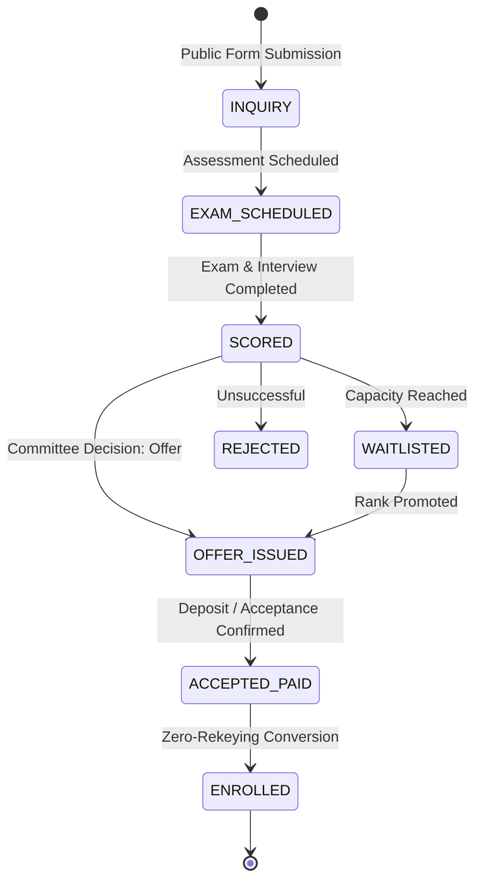

# Technical Architecture & Implementation Blueprint: Phase 4 Operations & Admissions CRM

This document provides the formal domain specifications, database models, state machines, statutory regulatory alignments, and engineering implementation roadmap for the 6 pended operational and lifecycle modules in **Octalve Edu** and **AlEemaan**:

1. **Extended HR & Payroll**
2. **Library Management**
3. **Transport & Fleet Operations**
4. **Inventory & Asset Management**
5. **Government / NEMIS Statutory Reporting**
6. **Admissions Pipeline & CRM (PRD §6 Line 113)**

---

## 1. Architectural Guardrails & Multi-Tenancy Principles

Across all 6 modules, the following core architecture rules apply unconditionally:

1. **Strict Multi-Tenant RLS Scoping:**
   - Every operational entity carries `tenantId String` indexed with composite keys `@@index([tenantId, ...])`.
   - All database reads and writes execute under Postgres Row-Level Security (`SET LOCAL app.tenant_id = :tenantId`).
   - Campus-level scoping (`campusId String?`) applies to physical inventory, vehicles, library branches, and school stops.
2. **Additive, Non-Breaking Schema Evolution:**
   - Existing tables (`StaffRecord`, `StudentRecord`, `GuardianRecord`, `Invoice`, `Transaction`) remain intact.
   - New capabilities connect via foreign keys, reference IDs, or polymorphic ledger entries.
3. **Audit Trail & Immutability:**
   - Financial operations (payroll disbursements, overdue fine payments, asset write-downs) must produce immutable ledger records. No hard deletions of audit logs.
4. **Offline & Solo Deployment Compatibility:**
   - Background jobs leverage Redis + BullMQ for asynchronous workloads (payroll batch calculation, census exports, bulk email notifications). Solo installs run the same services via Docker Compose.

---

## 2. Module 1: Extended HR & Payroll

### 2.1 Statutory & Domain Requirements
- **Regulatory Framework:** Compliance with the **Personal Income Tax Act (PITA)** as amended by recent Finance Acts, **Pension Reform Act 2014 (PRA)** (minimum 8% employee contribution, 10% employer contribution), and optional National Housing Fund (NHF - 2.5% of basic salary).
- **Salary Structure Components:**
  - **Earnings:** Basic Salary, Housing Allowance, Transport Allowance, Teaching/Duty Allowance, Overtime, Bonuses.
  - **Deductions:** PAYE Tax, Pension Fund, NHF, Staff Welfare/Cooperative, Disciplinary/Loan Repayments.
- **Workflow:**
  ```mermaid
  stateDiagram-v2
    [*] --> DRAFT: Initiate Monthly Run
    DRAFT --> CALCULATING: Trigger Batch Calculation
    CALCULATING --> REVIEW: Validation & Anomaly Checks
    REVIEW --> APPROVED: Bursar / Principal Sign-off
    APPROVED --> DISBURSED: Bank Batch / Paystack Transfer
    DISBURSED --> LOCKED: Payslips Published to Staff Portal
  ```

### 2.2 Proposed Prisma Schema
```prisma
enum PayrollStatus {
  DRAFT
  CALCULATING
  PENDING_APPROVAL
  APPROVED
  DISBURSED
  CANCELLED
}

enum SalaryComponentType {
  EARNING
  DEDUCTION
}

enum DeductionStatutoryType {
  NONE
  PAYE
  PENSION_EMPLOYEE
  PENSION_EMPLOYER
  NHF
}

model SalaryStructure {
  id          String   @id @default(cuid())
  tenantId    String
  campusId    String?
  name        String   // e.g. "Senior Academic Staff Level 10"
  description String?
  isActive    Boolean  @default(true)
  createdAt   DateTime @default(now())
  updatedAt   DateTime @updatedAt

  items       SalaryStructureItem[]
  staff       StaffSalaryAssignment[]

  @@unique([tenantId, name])
  @@index([tenantId, isActive])
}

model SalaryStructureItem {
  id                  String                 @id @default(cuid())
  structureId         String
  name                String                 // e.g. "Basic Salary", "Transport Allowance", "PAYE"
  type                SalaryComponentType
  statutoryType       DeductionStatutoryType @default(NONE)
  isPercentage        Boolean                @default(false)
  percentageOfField   String?                // e.g. "BASIC"
  amount              Decimal                @db.Decimal(12, 2)
  orderIndex          Int                    @default(0)

  structure           SalaryStructure        @relation(fields: [structureId], references: [id], onDelete: Cascade)

  @@index([structureId])
}

model StaffSalaryAssignment {
  id                  String          @id @default(cuid())
  tenantId            String
  staffRecordId       String          @unique
  salaryStructureId   String
  customBaseSalary    Decimal?        @db.Decimal(12, 2)
  pensionPin          String?
  pfaName             String?         // Pension Fund Administrator
  bankName            String?
  bankAccountNumber   String?
  bankCode            String?
  taxIdentificationNo String?         // TIN
  effectiveDate       DateTime        @db.Date
  createdAt           DateTime        @default(now())
  updatedAt           DateTime        @updatedAt

  staffRecord         StaffRecord     @relation(fields: [staffRecordId], references: [id], onDelete: Cascade)
  salaryStructure     SalaryStructure @relation(fields: [salaryStructureId], references: [id])

  @@index([tenantId, salaryStructureId])
}

model PayrollRun {
  id              String        @id @default(cuid())
  tenantId        String
  campusId        String?
  month           Int           // 1 - 12
  year            Int
  status          PayrollStatus @default(DRAFT)
  totalGross      Decimal       @default(0) @db.Decimal(14, 2)
  totalDeductions Decimal       @default(0) @db.Decimal(14, 2)
  totalNet        Decimal       @default(0) @db.Decimal(14, 2)
  approvedById    String?
  approvedAt      DateTime?
  disbursedAt     DateTime?
  createdAt       DateTime      @default(now())
  updatedAt       DateTime      @updatedAt

  items           Payslip[]

  @@unique([tenantId, year, month, campusId])
  @@index([tenantId, status])
}

model Payslip {
  id              String       @id @default(cuid())
  tenantId        String
  payrollRunId    String
  staffRecordId   String
  grossEarnings   Decimal      @db.Decimal(12, 2)
  totalDeductions Decimal      @db.Decimal(12, 2)
  netPay          Decimal      @db.Decimal(12, 2)
  breakdownJson   Json         // Detailed lines: Basic, Allowances, PAYE, Pension, etc.
  paymentRef      String?
  isSentToStaff   Boolean      @default(false)
  createdAt       DateTime     @default(now())

  payrollRun      PayrollRun   @relation(fields: [payrollRunId], references: [id], onDelete: Cascade)
  staffRecord     StaffRecord  @relation(fields: [staffRecordId], references: [id])

  @@unique([payrollRunId, staffRecordId])
  @@index([tenantId, staffRecordId])
}
```

---

## 3. Module 2: Library Management

### 3.1 Domain Requirements
- **Cataloging & Metadata:** ISBN lookup (OpenLibrary / Google Books API fallback), Dewey Decimal Classification (DDC), Call Numbers, Title, Authors, Publisher, Subject Tagging.
- **Copy-Level Inventory:** Distinguishes title catalog from physical barcodes/copies (`AVAILABLE`, `BORROWED`, `RESERVED`, `LOST`, `DAMAGED`).
- **Circulation Rules:**
  - Student loan limit: e.g. 2 books for 14 days.
  - Staff loan limit: e.g. 5 books for 30 days.
  - Automated grace period and overdue daily fine calculation (e.g. ₦100/day).
  - Integration with Finance Module: Unpaid library fines attach to term billing invoices.

### 3.2 Proposed Prisma Schema
```prisma
enum BookCopyStatus {
  AVAILABLE
  CHECKED_OUT
  RESERVED
  LOST
  DAMAGED
  UNDER_REPAIR
}

enum LoanStatus {
  ACTIVE
  RETURNED
  OVERDUE
  LOST
}

model LibraryBook {
  id              String     @id @default(cuid())
  tenantId        String
  campusId        String?
  isbn            String?
  title           String
  author          String
  publisher       String?
  edition         String?
  deweyDecimal    String?
  category        String?
  shelfLocation   String?    // e.g. "Rack B, Shelf 3"
  totalCopies     Int        @default(1)
  availableCopies Int        @default(1)
  createdAt       DateTime   @default(now())
  updatedAt       DateTime   @updatedAt

  copies          BookCopy[]

  @@index([tenantId, title])
  @@index([tenantId, isbn])
}

model BookCopy {
  id            String         @id @default(cuid())
  tenantId      String
  bookId        String
  barcode       String         @unique
  copyNumber    Int
  status        BookCopyStatus @default(AVAILABLE)
  acquiredDate  DateTime       @default(now()) @db.Date
  notes         String?

  book          LibraryBook    @relation(fields: [bookId], references: [id], onDelete: Cascade)
  loans         BookLoan[]

  @@index([tenantId, status])
}

model BookLoan {
  id            String      @id @default(cuid())
  tenantId      String
  copyId        String
  borrowerType  String      // "STUDENT" | "STAFF"
  studentId     String?
  staffId       String?
  issuedById    String      // Staff ID of librarian
  checkoutDate  DateTime    @default(now())
  dueDate       DateTime
  returnDate    DateTime?
  status        LoanStatus  @default(ACTIVE)
  fineAmount    Decimal     @default(0) @db.Decimal(10, 2)
  finePaid      Boolean     @default(false)
  notes         String?

  copy          BookCopy    @relation(fields: [copyId], references: [id])

  @@index([tenantId, status])
  @@index([tenantId, studentId])
  @@index([tenantId, staffId])
}
```

---

## 4. Module 3: Transport & Fleet Operations

### 4.1 Domain Requirements
- **Fleet Assets:** School buses, vans, assigned drivers, conductors, fuel records, and maintenance logs.
- **Routes & Stops:** Morning pickup and afternoon drop-off ordered waypoints with geocoded stop coordinates and estimated timings.
- **Passenger Allocation:** Student seat allocation per route/stop.
- **Billing Integration:** Transport subscriptions link directly into term fee schedules.
- **Daily Operations:** Driver/Conductor mobile-friendly check-in sheet (who boarded at each stop) with immediate parent SMS/push delivery.

### 4.2 Proposed Prisma Schema
```prisma
enum VehicleStatus {
  OPERATIONAL
  IN_MAINTENANCE
  OUT_OF_SERVICE
}

model SchoolVehicle {
  id              String        @id @default(cuid())
  tenantId        String
  campusId        String?
  registrationNo  String        // License Plate e.g. "LAG-452-XY"
  makeModel       String        // e.g. "Toyota Coaster 32-seater"
  capacity        Int
  status          VehicleStatus @default(OPERATIONAL)
  insuranceExpiry DateTime?     @db.Date
  roadWorthExpiry DateTime?     @db.Date
  createdAt       DateTime      @default(now())

  routes          TransportRoute[]
  maintenanceLogs VehicleMaintenance[]

  @@unique([tenantId, registrationNo])
}

model TransportRoute {
  id            String           @id @default(cuid())
  tenantId      String
  campusId      String?
  name          String           // e.g. "Lekki Phase 1 - Ikoyi Loop"
  vehicleId     String?
  driverStaffId String?          // StaffRecord ID
  isActive      Boolean          @default(true)

  vehicle       SchoolVehicle?   @relation(fields: [vehicleId], references: [id])
  stops         RouteStop[]
  subscriptions StudentTransportSubscription[]

  @@index([tenantId, isActive])
}

model RouteStop {
  id          String         @id @default(cuid())
  routeId     String
  stopName    String         // e.g. "Admiralty Way Junction"
  orderIndex  Int
  morningTime String?        // "06:45 AM"
  afternoonTime String?      // "03:30 PM"
  latitude    Float?
  longitude   Float?

  route       TransportRoute @relation(fields: [routeId], references: [id], onDelete: Cascade)

  @@index([routeId, orderIndex])
}

model StudentTransportSubscription {
  id            String         @id @default(cuid())
  tenantId      String
  studentId     String
  routeId       String
  stopId        String
  tripType      String         // "TWO_WAY" | "MORNING_ONLY" | "AFTERNOON_ONLY"
  termSessionId String
  isActive      Boolean        @default(true)

  route         TransportRoute @relation(fields: [routeId], references: [id])

  @@unique([tenantId, studentId, termSessionId])
  @@index([tenantId, routeId])
}

model VehicleMaintenance {
  id          String   @id @default(cuid())
  tenantId    String
  vehicleId   String
  serviceDate DateTime @db.Date
  cost        Decimal  @db.Decimal(10, 2)
  vendorName  String
  odometer    Int?
  description String

  vehicle     SchoolVehicle @relation(fields: [vehicleId], references: [id], onDelete: Cascade)

  @@index([tenantId, vehicleId])
}
```

---

## 5. Module 4: Inventory & Asset Management

### 5.1 Domain Requirements
- **Dual Asset Tracking:**
  - **Capital/Fixed Assets:** Lab equipment (microscopes, computers), furniture (desks, projectors) with serial tags, locations, and depreciation schedule.
  - **Consumable/Merchandise Inventory:** Uniforms, textbooks, stationery, answer booklets with minimum threshold re-order levels.
- **Store Requisition & Issuance:** Teacher/department submits material requisition -> storekeeper approves & issues -> inventory balance decreases.

### 5.2 Proposed Prisma Schema
```prisma
enum AssetType {
  FIXED_ASSET
  CONSUMABLE
}

model AssetCategory {
  id          String   @id @default(cuid())
  tenantId    String
  name        String   // "Science Lab", "IT Hardware", "Uniforms"
  type        AssetType
  createdAt   DateTime @default(now())

  items       InventoryItem[]

  @@unique([tenantId, name])
}

model InventoryItem {
  id              String        @id @default(cuid())
  tenantId        String
  campusId        String?
  categoryId      String
  sku             String?
  name            String
  quantityOnHand  Int           @default(0)
  reorderLevel    Int           @default(5)
  unitCost        Decimal       @default(0) @db.Decimal(10, 2)
  storageLocation String?       // "Main Store Room A"

  category        AssetCategory @relation(fields: [categoryId], references: [id])
  transactions    StockTransaction[]

  @@unique([tenantId, sku])
  @@index([tenantId, categoryId])
}

model StockTransaction {
  id            String        @id @default(cuid())
  tenantId      String
  itemId        String
  quantityDelta Int           // +50 (restock) or -2 (issued)
  transactionType String      // "PURCHASE" | "DISPATCH" | "WRITE_OFF" | "RETURN"
  recipientType String?       // "STUDENT" | "STAFF" | "DEPARTMENT"
  recipientId   String?
  authorizedById String
  date          DateTime      @default(now())
  notes         String?

  item          InventoryItem @relation(fields: [itemId], references: [id], onDelete: Cascade)

  @@index([tenantId, itemId])
}
```

---

## 6. Module 5: Government & NEMIS Reporting

### 6.1 Domain Requirements
- **Regulatory Framework:** Federal Ministry of Education (FME), National Personnel Audit (NPA / UBEC), and National Education Management Information System (NEMIS).
- **Statutory Census Elements:**
  - **Student Census:** Aggregate enrollment breakdown by Grade, Gender, Age Distribution, Special Needs (SEN), Repeaters, Dropouts, State of Origin, and LGA.
  - **Teacher & Staff Census:** Staff count by Gender, Qualifications (NCE, B.Ed, TRCN Registration Status), Designation, and Subject Specialization.
  - **Physical Infrastructure Audit:** Classroom counts, pupil-to-toilet ratio, water sources, electricity connectivity, library/lab availability.
- **Export Formats:**
  - Statutory NEMIS Excel Worksheets with locked formula headers.
  - Universal JSON/CSV datasets for State Ministry upload portals.

### 6.2 Proposed Service Architecture
```typescript
// src/lib/reporting/nemis/types.ts
export interface NemisStudentCensusRecord {
  gradeLevel: string;
  totalMale: number;
  totalFemale: number;
  ageDistribution: Record<string, { male: number; female: number }>;
  specialNeeds: { male: number; female: number };
}

export interface NemisTeacherCensusRecord {
  qualification: string; // "NCE", "B_ED", "PGDE", "MASTERS"
  trcnRegistered: boolean;
  maleCount: number;
  femaleCount: number;
}
```
Aggregations run directly on indexed Postgres tables via scoped transactional views (`WHERE tenant_id = app_tenant_id()`) preventing performance degradation during massive census exports.

---

## 7. Module 6: Admissions Pipeline & CRM (PRD §6 Line 113)

### 7.1 Lifecycle & Conversion Flow


### 7.2 Zero-Rekeying Promotion Engine
When an applicant transitions to `ENROLLED`:
1. Find or create `GuardianRecord` using verified NIN/Phone/Email.
2. Generate official Student Admission Number (e.g. `ADM/2026/042`).
3. Instantiate `StudentRecord` with applicant biodata, gender, date of birth, emergency contact, and links to the Guardian.
4. If opted, create student and guardian portal user accounts and dispatch welcome onboarding packets via SMS/Email.
5. All completed in a single atomic database transaction (`prisma.$transaction`).

### 7.3 Proposed Prisma Schema
```prisma
enum ApplicationStatus {
  SUBMITTED
  UNDER_REVIEW
  EXAM_SCHEDULED
  SCORED
  OFFERED
  WAITLISTED
  ACCEPTED
  ENROLLED
  REJECTED
  WITHDRAWN
}

model ProspectiveApplication {
  id                  String            @id @default(cuid())
  tenantId            String
  campusId            String?
  targetSessionId     String
  targetGradeId       String
  applicationNumber   String            @unique // e.g. "APP-2026-0012"
  status              ApplicationStatus @default(SUBMITTED)

  // Candidate Information
  firstName           String
  middleName          String?
  lastName            String
  gender              Gender
  dateOfBirth         DateTime          @db.Date
  nationality         String            @default("Nigerian")
  stateOfOrigin       String?
  lga                 String?
  previousSchool      String?
  lastClassPassed     String?

  // Primary Guardian Contact
  guardianFirstName   String
  guardianLastName    String
  guardianRelationship String
  guardianPhone       String
  guardianEmail       String
  guardianAddress     String?
  guardianOccupation  String?

  // Exam & Assessment
  examScheduledAt     DateTime?
  examScore           Decimal?          @db.Decimal(5, 2)
  interviewScore      Decimal?          @db.Decimal(5, 2)
  committeeNotes      String?
  offerLetterSentAt   DateTime?
  acceptancePaidAt    DateTime?
  waitlistRank        Int?

  // Resulting SIS link after conversion
  enrolledStudentId   String?           @unique

  createdAt           DateTime          @default(now())
  updatedAt           DateTime          @updatedAt

  documents           ApplicationDocument[]

  @@index([tenantId, status])
  @@index([tenantId, targetGradeId])
}

model ApplicationDocument {
  id            String                 @id @default(cuid())
  applicationId String
  documentType  String                 // "BIRTH_CERTIFICATE", "PREVIOUS_REPORT", "IMMUNIZATION"
  fileUrl       String
  fileName      String
  uploadedAt    DateTime               @default(now())

  application   ProspectiveApplication @relation(fields: [applicationId], references: [id], onDelete: Cascade)

  @@index([applicationId])
}
```

---

## 8. Implementation Sequencing & Phased Milestones

| Milestone | Target Module | Scope & Deliverables | Dependencies |
| :--- | :--- | :--- | :--- |
| **M1** | **Admissions CRM** | Public application portal, exam/interview scheduling, automated offer letters, zero-rekeying student enrollment. | Core SIS (Students, Guardians) |
| **M2** | **Extended HR & Payroll** | Salary structures, statutory deduction engines (PAYE, Pension), monthly run workflow, payslip generator. | Extended `StaffRecord` (Already landed) |
| **M3** | **Library Management** | Book cataloging, barcode copy tracking, circulation desk, overdue fine automation. | Core SIS (Students, Staff) |
| **M4** | **Transport & Fleet** | Bus fleet inventory, routes, ordered stops, passenger manifests, term transport billing. | Core SIS & Finance Billing |
| **M5** | **Inventory & Assets** | Store requisitions, lab equipment serial tracking, uniforms stock ledger, threshold alerts. | Multi-campus infrastructure |
| **M6** | **NEMIS / Statutory** | Automated MoE census generator, UBEC/NPA schema export, statutory analytics dashboard. | Core SIS, HR, Academics |

---

## 9. Verification & Quality Gates
- **Multi-Tenant Leak Audit:** Every new endpoint tested with cross-tenant IDOR attack suites.
- **Zero-Loss Data Conversions:** Admissions conversion benchmarked to verify 100% data fidelity when graduating prospect biodata into permanent SIS records.
- **Regulatory Sanity Checks:** Payroll tax brackets validated against current Lagos, Abuja (FCT), and Federal Internal Revenue Service (FIRS) statutory tables.
